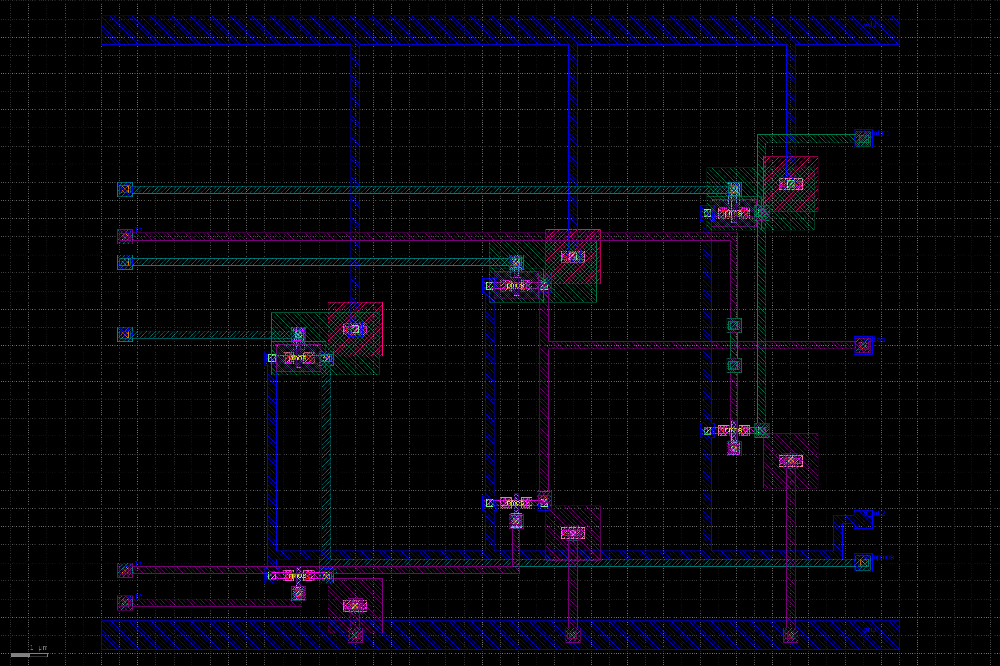
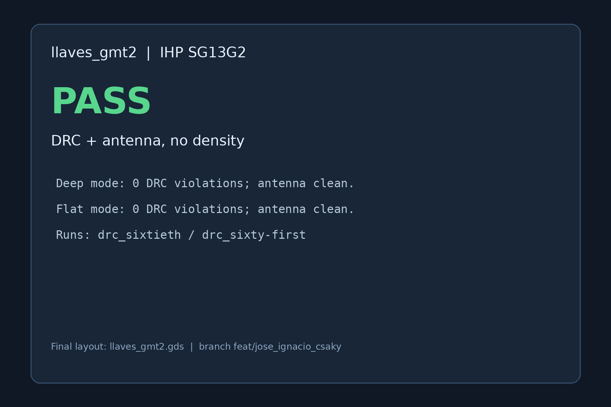
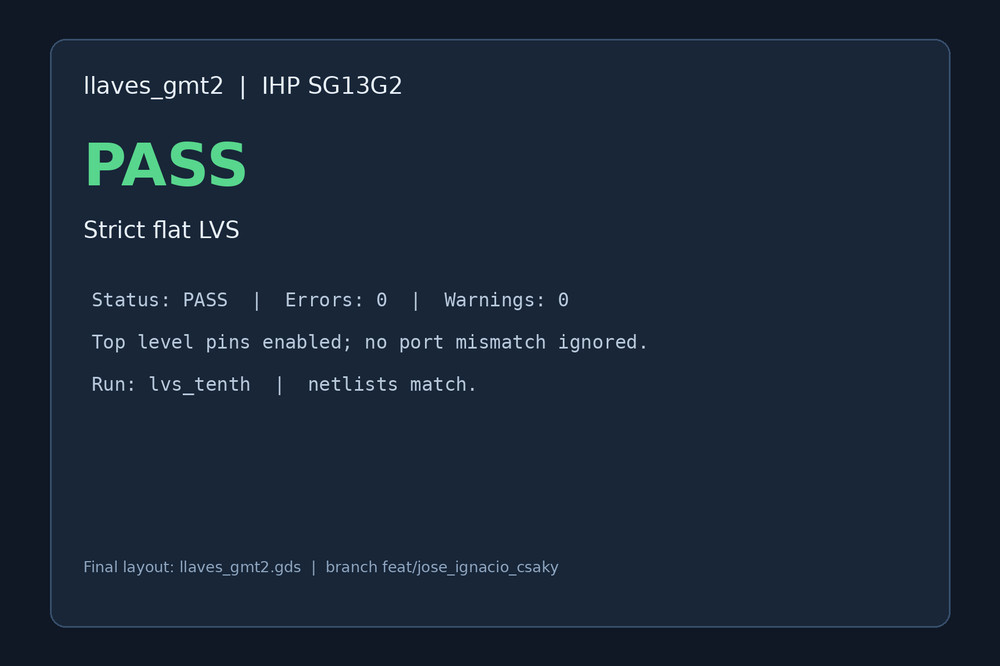
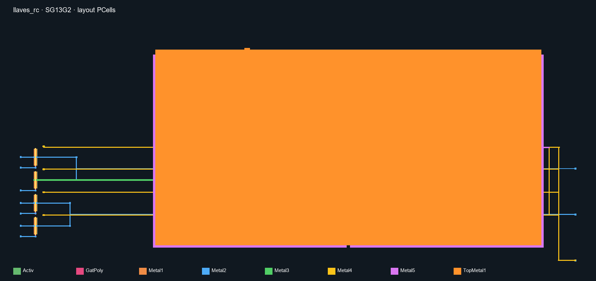
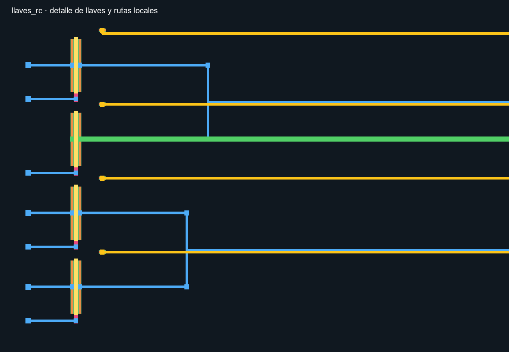
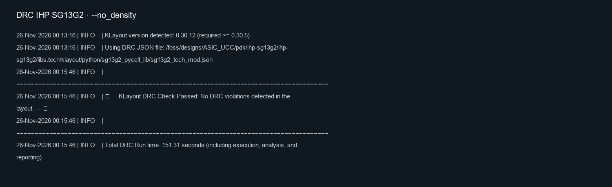
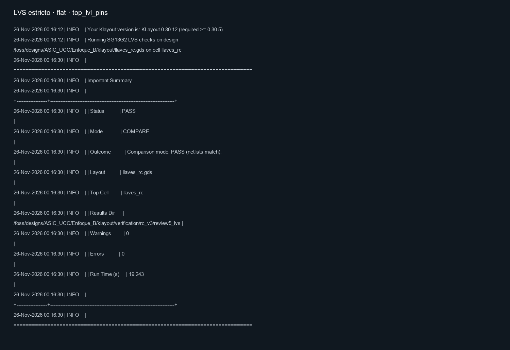

# Informe de correcciones del layout

**Enfoque B · IHP SG13G2**  
**Para:** Andrés y Lauti  
**Fecha:** 25 de noviembre de 2026  
**Rama consultada:** `feat/jose_ignacio_csaky`

## Resumen y estado

Se rehízo el layout de `llaves_gmt2` con MOS SG13_dev PCells, taps de bulk conectados a los rieles y rutas ortogonales. Se retiraron los diodos dantenna del esquemático y se resolvió antena con saltos de compuerta a Metal3. La corrida final documentada de GMT2 pasa DRC con `--no_density --antenna` en vistas deep y flat y pasa LVS estricto.

`llaves_rc` quedó **verificada**. Las corridas actuales pasan DRC `--no_density` (`rc_v3/review5_drc`), antena (`review5_ant`) y LVS estricto (`review5_lvs`). C1 se implementa con dos PCells `cmim` de 57,67 × 57,67 µm (≈10 pF). El informe de correcciones y las capturas actuales están disponibles junto a este documento y en `Capturas_layout_24-11-2026`.

| Celda | DRC y antena | LVS estricto | Estado al 25/11 |
|---|---|---|---|
| `llaves_gmt2` | PASS, 0 violaciones en `drc_sixtieth` (deep) y `drc_sixty-first` (flat) | PASS, 0 errores y 0 warnings, `lvs_tenth` | **OK** |
| `llaves_rc` | PASS, 0 violaciones en DRC `--no_density` (`review5_drc`) y DRC con antena (`review5_ant`) | PASS estricto, 0 errores y 0 warnings, `review5_lvs` | **OK** |

## Cambios pedidos y verificación

| Pedido del docente | Cambio realizado o previsto | Verificación y estado |
|---|---|---|
| Usar PCells SG13_dev para los dispositivos, sin dibujar MOS a mano | GMT2 instancia seis PCells `nmos`/`pmos` de W=0,15 µm y L=0,13 µm. RC instancia cuatro PCells `nmos`; C1 usa dos PCells `cmim`. | GMT2: LVS extrae seis MOS y pasa en modo estricto. RC: `review5_lvs` confirma los MOS y las dos CMIM como PCells (**OK**). |
| Quitar anillos de guarda y conectar bulk con `via_stack` a los rieles | Se quitaron los anillos. GMT2 conecta taps NMOS a GND y PMOS a VDD; RC conecta los taps NMOS a GND con stacks y rutas. | GMT2: DRC deep/flat y LVS confirman bulk NMOS a GND y PMOS a VDD. RC: DRC y LVS estrictos pasan; taps NMOS conectados a GND (**OK**). |
| Corregir antena con jumpers a Metal3, no con diodos | En GMT2 las seis compuertas saltan de GatPoly a Metal3; `sel2` usa además un puente M5 localizado. | `drc_sixtieth` y `drc_sixty-first`, con antena habilitada: cero violaciones (**OK GMT2**). RC: corrida combinada `review5_ant` sin violaciones de antena (**OK**). |
| Retirar los diodos dantenna del esquemático; `antennanp` solo aplica si una ruta llega a TopMetal2 | Se quitaron del esquemático los diodos `dantenna` agregados en una versión anterior. `antennanp` solo correspondería si una ruta alcanzara TopMetal2; no hay rutas que lo alcancen. | LVS estricto final confirma que GMT2 no contiene dispositivos de antena añadidos; RC también pasa `review5_ant` sin diodos (**OK en ambas**). |
| No usar `NoFillerStack` ni capas de bloqueo innecesarias | No se incluyeron esas capas; se redujeron las capas a las necesarias para contactos, rutas y pines. | Inspección de ambos generadores y resultados DRC limpios (**OK GMT2 y RC**). |
| Mantener ruteo ortogonal, PMOS arriba y NMOS abajo, con dispositivos agrupados | GMT2 dispone tres pares complementarios; las pistas son ortogonales. RC agrupa MN22–MN25 en dos pares funcionales. | Revisión visual de GMT2 y de las capturas `RC_layout.png`/`RC_layout_detalle.png` (**OK**). |
| En `llaves_rc`, instanciar C1 como `cmim` | C1 quedó representado por dos unidades `cmim` en paralelo, `m=2` en el esquemático; layout con dos variantes de PCell en paralelo. | Esquemático, generador y LVS estricto `review5_lvs` reconocen las dos CMIM conectadas (**OK**). |
| Usar TopMetal1 al mínimo | Se limita a una placa rectangular para el electrodo superior común de las dos CMIM y su conexión. | Inspección del layout y DRC `review5_drc` PASS (**OK**). |
| Mantener MN22–MN25 juntas y quitar metal suelto | Los cuatro NMOS se ubican en una sola hilera compacta y se conectan por segmentos de las redes previstas. | Generador, captura actual y DRC `review5_drc` PASS (**OK**). |
| Respetar anchos mínimos y encerrar las vías | Las rutas emplean anchos de 0,20–0,24 µm según neta y las transiciones usan `via_stack`; se añadieron landings locales. | GMT2: DRC deep/flat en cero. RC: DRC `review5_drc` PASS sin violaciones (**OK**). |
| Sacar todas las entradas de señal por el mismo lado | GMT2 lleva los seis controles hacia el borde izquierdo. RC dispone los cuatro controles en tracks de entrada del lado izquierdo. | LVS estricto y capturas actuales de ambas celdas (**OK**). |

## Celda `llaves_gmt2`

La celda implementa tres llaves de transmisión CMOS. En cada par, un NMOS con bulk a GND y un PMOS con bulk a VDD conectan el nodo común `g_mt2` con una salida (`s_mpmos`, `vbias` o `s_mtr1`). Las compuertas complementarias (`sel0/u`, `sel1/t`, `sel2/v`) controlan cada pareja. La disposición deja PMOS arriba y NMOS abajo.

**Captura de layout — versión verificada**



**Evidencia de verificación**

- DRC deep, `--no_density --antenna`: PASS, 0 violaciones — `Enfoque_B/klayout/verification/gmt2_v3/drc_sixtieth/`.
- DRC flat, `--no_density --antenna`: PASS, 0 violaciones — `Enfoque_B/klayout/verification/gmt2_v3/drc_sixty-first/`.
- LVS estricto flat, puertos top-level activos y sin ignorar discrepancias: PASS, 0 errores y 0 warnings — `Enfoque_B/klayout/verification/gmt2_v3/lvs_tenth/`.
- La antena queda resuelta mediante jumpers; los logs de DRC incluyen reglas de antena y no registran violaciones.





**Observación física:** los pares PMOS/NMOS quedaron algo escalonados y en diagonal. Cumplen la orientación vertical pedida, aunque se podrían compactar y alinear más en una iteración posterior.

## Celda `llaves_rc` — verificada

La celda conmuta señales analógicas con cuatro NMOS: MN22/MN23 seleccionan entre `rref_ext` y `rsens_ext` hacia `s_m0`; MN24/MN25 seleccionan entre `c1_int` y `csens_ext` hacia `s_m1`. C1 es la referencia capacitiva integrada conectada entre `c1_int` y GND: dos PCells `cmim` independientes, cada una con w=l=57,67 µm y m=1, equivalentes a aproximadamente 4,99 pF por unidad (≈9,98 pF total, consigna 10 pF). Los cuatro controles son `sel3`–`sel6` y los bulks van a GND. Las verificaciones PASS corresponden al GDS generado a las 20:13.

**Capturas del layout verificado**





La vista general muestra la capa TopMetal1 sobre el conjunto de MIM; el detalle permite observar los dispositivos y escapes locales. Ambas capturas fueron generadas para la revisión del GDS verificado.

**Resultados de verificación**

- DRC IHP SG13G2 con `--no_density`: PASS, cero violaciones — `Enfoque_B/klayout/verification/rc_v3/review5_drc/`.
- Antena: PASS, cero violaciones — corrida combinada `Enfoque_B/klayout/verification/rc_v3/review5_ant/`.
- LVS flat estricto, `--top_lvl_pins`, sin ignorar discrepancias de puertos: PASS, cero errores y cero warnings — `Enfoque_B/klayout/verification/rc_v3/review5_lvs/`.






## Decisiones y justificaciones

- **DRC sin reglas de densidad:** los chequeos informados para GMT2 usan `--no_density`; el relleno de densidad se agrega en el top por el docente/integrador. Así se evalúan las reglas de geometría y conectividad de las celdas sin anticipar el patrón de fill global.
- **C1 de 57,68 a 57,67 µm:** la PCell `cmim` de este PDK genera un cuadrado de 57,67 × 57,67 µm para la unidad seleccionada. Dos unidades de aproximadamente 4,99 pF en paralelo cumplen la consigna de C1 = 10 pF (≈9,98 pF nominal según la aproximación de la consigna). El valor de layout se ajusta a la geometría que produce la PCell, sin cambiar la intención eléctrica.
- **Diodos dantenna retirados del esquemático:** la revisión corrigió el netlist al quitar esos diodos. `antennanp` solo correspondería si alguna ruta llegara a TopMetal2; no hay rutas que alcancen esa capa. La antena de GMT2 se resuelve con jumpers a Metal3 y en RC pasa el chequeo combinado sin diodos.

## Pendientes y observaciones no bloqueantes

1. En RC, acortar `c1_int` (aproximadamente 100 µm).
2. En GMT2, acortar el bus `g_mt2` y compactar/alinear mejor los pares PMOS/NMOS.
3. Confirmar el floorplan y la ubicación/nombres de pines con el integrador antes de la integración en el top.

## Pasos para reproducir

Ejecutar dentro del contenedor del proyecto con PDK IHP SG13G2 inicializado. Estos son los generadores registrados; no se ejecutaron al preparar este informe.

```bash
cd /foss/designs/ASIC_UCC
bash scripts/setup.sh --check
klayout -b -r Enfoque_B/klayout/scripts/rebuild_gmt2.py
klayout -b -r Enfoque_B/klayout/scripts/build_rc.py
```

Luego, sobre cada GDS (`Enfoque_B/klayout/llaves_gmt2.gds` y `llaves_rc.gds`), correr el macro DRC de SG13G2 de KLayout con `--no_density --antenna` y guardar la corrida en `Enfoque_B/klayout/verification/<celda>_v3/`. Ejecutar LVS SG13G2 en modo estricto, con pines top-level y comparación de puertos habilitados; guardar el netlist extraído y el log. Para GMT2, las corridas finales que se deben consultar son `drc_sixtieth`, `drc_sixty-first` y `lvs_tenth`. En RC, los resultados finales están en `review5_drc`, `review5_ant` y `review5_lvs`; conservar esos logs junto al GDS publicado.

Los scripts de layout son `Enfoque_B/klayout/scripts/rebuild_gmt2.py` y `Enfoque_B/klayout/scripts/build_rc.py`. Ambos GDS guardan `$$$CONTEXT_INFO$$$` con `LIB=SG13_dev` y los parámetros de instancia; al abrirlos con el PDK cargado, las PCells se reconstruyen editables y pueden inspeccionarse con la tecla `Q`.

**Publicación:** commit `108d9cc` — `fix(enfoque_b): rehacer llaves_gmt2 y llaves_rc según correcciones del docente`. Está subido a `origin/feat/jose_ignacio_csaky`; no se abrió PR.

